# Architecture

How a capture travels from a keypress to a note in the Inbox, and the few
invariants that are not visible from reading any single file.

The [README](README.md) has the file map; this does not repeat it. Where the two
disagree, the code is right.

## The shape

One process serves the API, the built SPA and the SSE stream. The Electron shell
supervises it and injects a bearer token for tray-originated writes. There is no
queue server, no worker process, no cache to invalidate — SQLite in WAL mode is
the only state.

```
   Electron shell ──wtype/clipboard──┐
   browser HUD ──────────────────────┤
   bin/flee ─────────────────────────┼──▶ POST /api/capture/{text,audio,youtube}
   capture templates ────────────────┘              │
                                                   ▼
                                    insert_note(status=pending)
                                                   │
                                     bus.publish("note.created")
                                                   │
                                                   ▼
                                      Processor.enqueue ──▶ asyncio.Queue
                                                   │      (2 workers, cap 500)
                                                   ▼
                              transcribe ──▶ enrich ──▶ update + publish
```

## A capture, end to end

```mermaid
sequenceDiagram
    autonumber
    participant C as Client<br/>(HUD, flee, tray)
    participant R as POST /api/capture/text
    participant D as SQLite
    participant B as EventBus
    participant P as Processor<br/>(2 workers)
    participant T as Transcriber
    participant L as LLM
    participant S as SSE stream

    C->>R: capture
    R->>D: INSERT note (status=pending)
    R->>B: publish note.created
    R-->>C: 200 immediately
    Note over R,C: the client is not made to wait

    B-->>S: note.created
    S-->>C: card appears, still "pending"

    P->>T: transcribe (only if type=voice and audio_path)
    T-->>P: {text, duration, language, words?}
    P->>D: raw_text, transcription
    Note over P,D: #91 deletes the audio here —<br/>but only on success, so a<br/>failed model never costs the memo

    P->>L: enrich (system prompt + captured text)
    alt LLMUnavailable
        L-->>P: raises
        P->>P: heuristic_enrich(text)
        Note over P: the capture still lands.<br/>A model outage must not look<br/>like data loss.
    else answered
        L-->>P: {title, summary, tags, action_items, confidence}
        P->>D: action_items → tasks table
    end

    P->>D: status=done, processed_at, enrich_ms
    P->>B: publish note.updated
    B-->>S: note.updated
    S-->>C: card fills in
```



## Invariants worth knowing

**Every write the UI must see live publishes an event.** A write that does not is
not invisible — it is a card that sits stale until the user navigates away and
back. The event names are load-bearing on the frontend: a `bus.publish` with no
matching branch in `serverEvents.ts` fails silently.

**Timestamps arrive in two frames.** `created_at` and `processed_at` are UTC ISO;
sessions and "today" are local. Comparing `ts[:10]` against a local date puts
completions on the wrong side of local midnight, so day boundaries route through
`calendar_svc.date_tag`.

**The LLM is an enhancement, not a dependency.** Every capture path degrades to
`heuristic_enrich`. `notes.generated` marks what came back from the vault rather
than from a capture, and the urgency and clarity keys read it.

**Filenames cannot be steered by user text.** `note_filename` is date + id. A
title is metadata, not a path.

**Migrations are append-only, and three things run on every boot.** `MIGRATIONS`
in `db.py` are applied once and tracked in `schema_version`. Separately —
*not* version-gated — `migrate()` also runs `_migrate_guarded_columns`,
`_backfill_activity_index` and `_migrate_action_items` each time. That last one
is why it needs its own care: it is a data migration wearing a boot hook's
clothes, and it has to be idempotent against notes that `insert_note` has
already promoted.

## Concurrency

`Processor.WORKERS = 2` is a deliberate ceiling. A YouTube capture can chain
roughly twenty minutes of subprocess work behind one worker (yt-dlp metadata and
subtitles, possibly an audio download, ffmpeg, then whisper), and every other
capture waits behind it — but the second worker exists precisely so it does not
wait behind *all of them*. Blocking calls run in threads, never on the event
loop.

The activity collector polls Hyprland on its own timer and runs its state
machine separately from the probes, so tests can drive it without a compositor.

## Where things are

- `fleeting/main.py` — app factory, lifespan, day-rollover
- `fleeting/db.py` — schema, migrations, FTS triggers, task promotion
- `fleeting/process.py` — the pipeline above
- `fleeting/events.py` — the in-process bus behind SSE
- `frontend/src/components/serverEvents.ts` — the reducer; the other half of
  every `bus.publish`