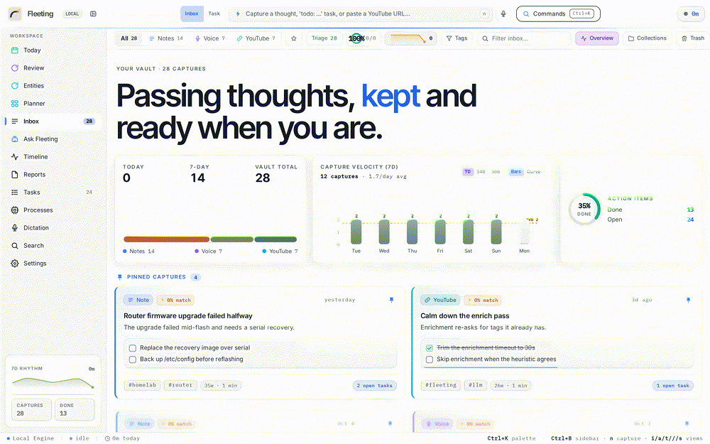

# ⚡ Fleeting

**A local-first memory inbox for your computer.** Voice memos, stray thoughts and
YouTube links go in — clean, titled, tagged, searchable notes come out. Meanwhile
Fleeting quietly watches which windows you work in and writes you a **daily log**
with your local LLM. Everything runs on your machine: no cloud, no API keys, no
telemetry.

> "If the cloud goes down, my tools should still work." — this one does.

```
┌────────────┐   ┌──────────────┐   ┌───────────────┐   ┌──────────────┐
│  capture   │ → │  transcribe  │ → │   organize    │ → │  file & sync │
│ text/mic/  │   │  faster-     │   │ local LLM via │   │ SQLite FTS5  │
│ youtube    │   │  whisper     │   │  Ollama       │   │ markdown vault│
└────────────┘   └──────────────┘   └───────────────┘   └──────────────┘

┌────────────┐   ┌──────────────────────────────────────────────┐
│  observe   │ → │  daily log: compact sessions → LLM summary   │
│ hyprctl    │   │ mirrored to <vault>/Daily/YYYY-MM-DD.md      │
└────────────┘   └──────────────────────────────────────────────┘
```



Seeded demo data, captured from the real app — the middle of the loop is a
capture made somewhere else landing in the inbox without a reload.

## What it does

- **Capture anything, instantly** — type in the always-present bar, hit the mic
  for a voice memo (recorded in the browser), or paste a YouTube URL. Processing
  happens in the background with live SSE updates in the UI.
- **Voice memos → text** — [faster-whisper](https://github.com/SYSTRAN/faster-whisper)
  (CPU, int8) transcribes fully offline. Model size: tiny → medium.
- **YouTube → notes** — [yt-dlp](https://github.com/yt-dlp/yt-dlp) pulls metadata
  and captions; caption-less videos fall back to local audio transcription
  (opt-in, duration-capped).
- **Local LLM organizes everything** — your Ollama (or LM Studio) model turns raw
  captures into a title, a summary, tags and concrete action items. If the LLM is
  down, a built-in heuristic pass keeps the app fully functional.
- **Tasks surface automatically** — every "remember to…" becomes a checkbox in
  the Tasks view, linked back to its note.
- **Timeline — your day, logged** — a background collector (Hyprland `hyprctl`)
  tracks the active window, merges it into compact sessions with real active
  seconds (idle detection via cursor stillness), and shows a live "on your
  screen now" card, a per-app time-split bar and a chronological session feed.
- **It knows what you saved, not just where you were** — the daily report also
  scans your watch dirs (`~/Projects`, `~/Documents`, `~/Downloads`) for files
  modified in the window and pulls git commit subjects — metadata only, never
  file contents. The report can therefore say *what* you built, not just which
  app was open.
- **Daily report at 12:00 AM, past 24 hours, inside the app** — every midnight
  the local model compacts the past 24 hours (window sessions + save-file
  activity + commits) into a readable markdown report — overview, time split,
  what happened, threads & loose ends — delivered in the app (with a toast when
  it lands). If the laptop was off at midnight, it's written on next startup.
  Falls back to a deterministic digest when the model is unreachable. Reports
  live in the app; an optional settings toggle also mirrors them to the vault.
- **Per-app tracing switches** — Settings lists every app the tracker has seen
  with an individual on/off toggle; a blocklist (zen browser by default) keeps
  chosen apps out entirely.
- **Everything is searchable** — SQLite FTS5 over titles, transcripts and tags
  with highlighted snippets, optionally reranked against note embeddings.
- **Process view** — active windows and a sortable process list with CPU and
  memory, per-process runtime details, and terminate. Hyprland is the supported
  compositor; Sway and X11/wmctrl are attempted as fallbacks.
- **Your data stays yours** — one SQLite file plus plain Markdown in your vault.
  Pause tracking any time from the Timeline view; exclude apps by name in
  settings. Nothing ever leaves the machine.

## It's a desktop app

The real shell is **Electron** (`electron/main.cjs`, launched by `bin/fleeting-app`).
It gives you:

- **Auto-backend** — probes `127.0.0.1:7425` and starts the FastAPI server itself
  if nothing answers, so there is no second thing to launch.
- **System tray icon** with a tooltip, plus window position/size persistence.
- **A dictation HUD** — a separate always-on-top, all-workspaces window
  (`?mode=hud`) toggled by <kbd>Ctrl</kbd>+<kbd>Alt</kbd>+<kbd>Space</kbd>, so the
  mic is always one keypress away without covering your work.

`scripts/install-app.sh` installs a launcher entry ("Fleeting" in wofi/rofi)
with an icon that runs `fleeting-app`, which locates your `electron` binary.

> Window note: the shell sets `StartupWMClass=fleeting`, so Hyprland rules match
> on `class:^(fleeting)$` — for example
> `windowrulev2 = pin, class:^(fleeting)$`.

## Stack

| Layer     | Tech                                                        |
| --------- | ----------------------------------------------------------- |
| Backend   | Python 3.13, FastAPI, SQLite (WAL + FTS5), asyncio workers   |
| AI        | faster-whisper (local STT), Ollama / LM Studio (local LLM)  |
| Ingestion | yt-dlp, ffmpeg, hyprctl (activity), psutil (process view)   |
| Frontend  | React 19, Vite 7, Tailwind 4, TypeScript                    |
| Realtime  | Server-Sent Events                                          |
| Shell     | Electron (tray, HUD, auto-backend), systemd user service     |

## Setup (Arch / Omarchy)

```bash
cd ~/Projects/fleeting
./scripts/install.sh          # uv sync + bun/npm build
./scripts/install-app.sh      # launcher entry, icon, `flee` on PATH
./scripts/dev-restart.sh      # start the server
```

Open the **Fleeting** entry in your launcher (or http://127.0.0.1:7425).
First boot auto-detects your Ollama model and creates
`~/.config/fleeting/config.toml`.

Requirements: `uv`, `bun` (or npm), `ffmpeg`, `yt-dlp`, and Hyprland's
`hyprctl` for activity tracking. `electron` (or `electron43`) is needed for the
desktop shell. The whisper model downloads once on first
voice capture (`base` is ~75 MB and usually already in your HuggingFace cache).

### Run as a service (survives reboots)

```bash
cp deploy/fleeting.service ~/.config/systemd/user/
systemctl --user daemon-reload
systemctl --user enable --now fleeting
```

### Quick capture from anywhere

```bash
flee "ship the portfolio site"              # capture a thought
echo "check the invoice" | flee             # from a pipe
flee --youtube https://youtu.be/aircAruvnKk # send a video
```

### Experimental endpoints

Three things shipped before anything was built to reach them. They are **off** by
default; turn one on in `~/.config/fleeting/config.toml`:

```toml
[experimental]
tone = true            # GET  /api/notes/tone          urgency/sentiment ordering
benchmark = true       # POST /api/benchmark/run      score models on your own notes
pinned_context = true  # notes pinned into an assistant thread
sql_console = true      # POST /api/sql                 read-only SELECT over the schema
```

`GET /api/health` reports which are on. They are gated with a **404** rather than
a 403, so an off flag looks exactly like a route that was never written.

## Configuration

`~/.config/fleeting/config.toml` (also editable in the Settings UI):

```toml
[paths]
vault_dir = "~/Documents/FleetingVault"   # markdown mirror
vault_sync = true

[llm]
provider = "ollama"            # ollama | lmstudio | custom | none
base_url = "http://127.0.0.1:11434"
model = ""                     # empty = auto-detect first chat-capable model
api_key = ""                   # optional bearer token for custom/OpenAI-compatible

[transcribe]
model = "base"                 # tiny | base | small | medium
language = "auto"

[youtube]
transcribe_fallback = true     # whisper videos without captions
max_duration_min = 45

[activity]
enabled = true                 # requires restart when toggled
poll_secs = 20
idle_after_min = 3             # cursor-still minutes = away
excluded_apps = "zen"          # never traced, regardless of per-app toggles
auto_daily_log = true          # past-24h report at 12:00 AM
watch_dirs = "~/Projects, ~/Documents, ~/Downloads"
mirror_daily_log = false       # reports live in the app; flip to also mirror

[notifications]
desktop = true
```

Data lives in `~/.local/share/fleeting/` (`fleeting.db` + audio). The server
binds to `127.0.0.1` only — it is a single-user local app.

If you set an `api_key` it is stored **in plaintext** in
`~/.config/fleeting/config.toml`; keep that file readable only by you. The
Settings API never returns the stored key, only whether one is set.

Because a browser will happily fire a cross-origin `POST` at a loopback port
without any user intent, every mutating `/api` request must carry an `Origin`
header belonging to the app itself (or the Vite dev server). Requests with no
`Origin` — `curl`, the `flee` CLI, scripts — are unaffected. A future browser
extension will therefore need to declare itself allowed here rather than assume
it can post freely.

For how a capture actually travels through the app — and the invariants that
are not visible from reading any single file — see
[ARCHITECTURE.md](ARCHITECTURE.md).

## Layout

```
backend/
  fleeting/
    main.py            app factory, SPA + app-window serving, lifespan
    config.py          TOML config, XDG paths
    db.py              SQLite + FTS5 + migrations (notes, activity, daily_logs, kv)
    process.py         capture pipeline (transcribe → enrich → sync)
    activity.py        Hyprland window tracker (idle-aware session state machine)
    events.py          SSE event bus
    services/          llm, transcribe, youtube, markdown, dailylog
    routers/           notes, capture, search, settings, system, activity, processes
  tests/               pytest (API E2E, collector, daily log, markdown, subtitles)
frontend/              React 19 + Tailwind 4 SPA (Inbox, Timeline, Tasks, Search, Settings)
electron/              desktop shell: tray, HUD window, backend supervision
scripts/               install.sh, install-app.sh, dev-restart.sh
deploy/                systemd user unit, .desktop entry, app icon
bin/                   flee (CLI capture), fleeting-app (desktop launcher)
```

## Plugins

A folder in `~/.config/fleeting/plugins/` with a `plugin.json` declaring capture
sources, enrichers and views. `GET /api/plugins` lists them and reports what is
wrong with the ones that will not load.

The manifest is a **catalogue, not an execution vector**. Running things is
[hooks](#hooks) and `actions.toml`, which are opt-in per file; a manifest only
*names* a hook, and that hook still has to be installed by you. The loader copies
only keys it knows, so a `"command"` or `"script"` field in a manifest is dropped
without being read — a plugin folder someone sent you is data, not code.

See `plugins/README.md` for the format and `plugins/notion-sync/` for a worked
example.

## Backups

Every pre-migration backup (#188) is recorded in `backups.index.jsonl` beside the
database, and `GET /api/backups` lists them with a verdict.

The index is **hash-chained**: each entry carries the hash of the entry before
it, so editing or removing one breaks every hash after it. A plain list of
hashes would not help — an index is a file, and whoever replaces a backup can
rewrite its row so the index still verifies.

That detects accidental corruption, an interrupted write, and casual editing.
It is **not** a signature and not encryption: anyone who can write the index can
recompute the whole chain.

## What it stores

`GET /api/inventory`, and Settings → **System** under Storage. Every category
with its size, largest first — notes, tasks, activity, the database file, audio,
attachments, the vault export and the log.

Bytes come from the filesystem, not from summing column lengths: a blob, an
audio file and a row of text are not comparable, and `length()` under-reports by
the page overhead SQLite actually spends. The database is `page_count *
page_size`, which is the number disk-usage tools show.

`deletable` is on every row, because that is the field that stops it
misreporting: notes come from a capture, and the database file does not shrink
because you deleted a note. Trashed notes are counted separately — they are
still on disk.

## Secrets

API keys, the Hugging Face token and the activity token are stored in the
**OS keyring** where one exists (`secret-tool` on Linux, `keyring` elsewhere), and
`GET /api/keyring` reports which store is in use and whether it is a real one.

`config.toml` keeps a marker — `<stored in keyring>` — so the file says *that* a
key exists without saying what it is. A leaked config therefore reveals nothing
usable, and a dotfile repo stops being a liability.

On a machine with no keyring the fallback is a `0600` file in the same config
directory, and the API reports `secure: false` with the path. That is a
downgrade, so it is stated rather than silent — a file mode is not a keyring, and
saying so is the difference between a tradeoff and a surprise.

Sending an empty key through Settings clears it. "Revoke the key I no longer
want lying around" is a thing people need to do, so leaving the old one behind
was not an option.

## Requiring a token for reads

By default the API token guards **writes** only, and `/api/health` is exempt so the
app can come up before it has a token. That means a local process could `curl`
every note out of the running app.

Set `activity.reads_require_token = true` to close that. The SSE stream carries its
token as `?token=` because `EventSource` cannot set an `Authorization` header — the
header is still tried first, since a query string ends up in proxy logs and shell
history.

**It is off by default, and that is a real constraint rather than caution.** The SPA
is served from the same origin it calls, so a page cannot hold a secret it then sends
to its own origin — anything in the page is readable by the page. Turning this on
would break the browser app rather than protect it. The Origin guard already covers
the browser case; this setting is for when your clients are `flee`, curl and MCP, and
another local process reading your notes is the thing you want stopped.

## Signed releases

`scripts/sign_release.py` signs the built artifacts and verifies them before they ship.

```bash
python scripts/sign_release.py keygen                    # key into the OS keyring
python scripts/sign_release.py sign dist/*.AppImage dist/*.deb
python scripts/sign_release.py verify dist/fleeting.AppImage
```

It writes `SHA256SUMS` (standard `sha256sum` format, so a coreutils box can check the
digests alone) and one `SHA256SUMS.sig`. **The signature covers the digest file, not
each artifact** — signing artifacts individually would let one file be swapped while
every other signature stayed valid. Verification checks both: the digest is compared
against the bytes on disk right now, and the digest file against the signature. Anyone
can edit `SHA256SUMS` to match a modified binary; that is what the second check is for.

Ed25519 from `cryptography`, already a dependency. The private key goes to the OS
keyring — a signing key stored beside the artifacts it signs protects nothing — and
`keygen` reports honestly when there is no real keyring and it fell back to a file.

**What a signature here does not prove.** That these bytes came from whoever holds
the private key. Not that they are safe to run, and not that the build machine was
honest: the key signs what it is given, so a compromised builder with the key
produces a valid signature of a compromised binary. True of every signature that
does not also record provenance, and worth writing down rather than letting "signed"
imply more than it means.

## The HTTP API

[`API.md`](API.md) is the generated reference: every endpoint, its method, its
status codes and what each code means. It is generated from the OpenAPI spec by
`scripts/gen_api_docs.py` and committed, and a test regenerates and compares it —
so it cannot drift.

The spec itself carries the parts a code generator actually needs: a declared
`bearerAuth` scheme (marked **optional**, because saying "you need a token" to
someone who has none is worse than saying nothing), the local server URL, and
prose covering the three guards. Each claim in that prose is tested against the
running application, because documentation of a security control that has
drifted is the exact failure it exists to prevent.

`/api` is additive: new endpoints and optional fields may appear in any release,
and a removal takes a `/api/v2` prefix rather than happening silently.

## Locking the app

`POST /api/lock/set` with a passphrase locks the app until it is given. Everything
under `/api` answers `423` except `/api/health`, `/api/lock/status` and
`/api/lock/unlock` — a lock you can read data through is not a lock.

**The passphrase is never stored.** Only a scrypt hash with a per-install salt.
`config.toml` is world-readable in most installs, ends up in dotfile repos and goes
into backups; a config containing the thing it protects is a note about where to look.

**Guessing is throttled** after three failures, doubling each time and capped at 30
seconds. Three guesses a second turns a 32-character passphrase into a few hours of
offline cracking; an *uncapped* delay would turn the lockout into an outage, and the
app has to stay openable by the person who owns it.

Unlocking is per-process, so restarting relocks — the right default for a laptop you
closed and handed to someone. The token travels in `X-Fleeting-Lock`, separate from
the API token: different secrets, different lifetimes.

`/api/lock/set` is deliberately **not** exempt. Being able to change the passphrase
while locked is being able to turn the lock off, which is the thing it prevents.

## Nothing is deleted without a window

Every delete in the app is a trash first. `notes.trash_retention_days` is what turns
that permanent — the first stage is the recoverable one.

Two paths did not do this, and both mattered more than they look:

- **The assistant's `delete_note` tool used to hard-delete.** It is a *tool call*,
  so the caller can be a model that decided a note was not worth keeping, and a
  model that is wrong about that is precisely the mistake you cannot undo. It now
  trashes, and reports `recoverable: true` so the caller knows.
- **`POST /api/notes/{id}/purge` accepted any note and asked for no confirmation.**
  A mistyped URL was enough to destroy something. It now refuses a note that is not
  already in the trash, and wants an explicit `confirm`.

Purging what is already in the trash is still allowed — that is what the button is
for. And `POST /api/forget` is still a hard delete, because irreversibility is the
entire point of a panic button.

A test asserts that no module hard-deletes outside those two, so the *next* path
that appears is caught too.

## Keeping less

`notes.retention_by_source` sets how long each capture source stays in the database
at all — `"youtube:7, file:30"`, in days, keyed on `notes.type`. A YouTube
transcript and a note you wrote are not the same kind of thing, and a single
global age treats them as though they were.

**There is no catch-all.** A source not named is never aged out. A policy that
quietly applied to everything would age out the notes you wrote in favour of the
ones you were dictated — the exact inverse of what the feature is for.

**Retention trashes; it does not delete.** `notes.trash_retention_days` is what
turns that permanent. Both stages matter — the first is the recoverable one. A
policy that hard-deleted would be a slow-motion version of the panic button: data
gone on a timer you set once and forgot, with no window in which to notice.

`GET /api/retention` reports the policies, what was ignored (a typo is dropped
rather than stopping the app from starting, but it is not swallowed), and what is
currently due. Policies run on boot, with the rest of the maintenance.

## What file-activity scanning may read

`activity.watch_allowlist` names the directories that save-file scanning is allowed
to read. **It ships empty**, which is the point: the previous default scanned
`~/Projects`, `~/Documents` and `~/Downloads` without asking. An allow-list that
ships full is not an allow-list, it is a default with extra steps.

Anything not named is never scanned, including by the daily report, the weekly log,
the standup, periodic reviews, "what shipped", repo discovery and the activity
collector itself — there were seven call sites, and a guard the ticket named is not
a guard the other six obey.

System paths (`/etc`, `/usr`, `/`, `/proc`…) are refused whatever the allow-list
says. A missing leading slash in `Projects` turns a scan of your work into a walk of
the root filesystem, and the result is a daily report built from `/etc`.

`GET /api/activity/files/preview` shows what each directory would contribute before
you rely on it — counts per project folder, never a filename. Rejections carry a
reason, because a directory missing from the preview is otherwise indistinguishable
from one ignored by a typo, and "I typed it and nothing happened" is the report you
cannot act on.

## Demo mode

Set `server.demo_mode = true` for a read-only instance — for screenshots, a talk,
or trying the app on someone else's machine. Every mutating `/api` call is refused
with a 403 naming the setting, and the UI shows a banner rather than letting
someone discover read-only-ness by failing to save.

**The guard is middleware, not a per-route flag.** A guard each endpoint has to
remember to check is a guard the next endpoint forgets, and the failure is
invisible: a demo that quietly wrote to the data it is demonstrating looks
exactly like a demo that worked.

**Seeding only touches an empty database.** A demo with an empty inbox
demonstrates nothing, so startup fills one — but only if there is nothing there.
Switching the flag on over real data leaves your notes alone, which is the one
thing a demo must never do.

## Long pastes

A long paste is enriched in chunks rather than sent as one prompt. Sent whole it
either blows the context window — dropping to heuristics, so the note looks like it was
never enriched — or gets truncated by the provider, which is worse: a confident summary
of the first tenth presented as though it covered everything.

Chunks break on paragraph boundaries, because a chunk ending mid-sentence produces a
summary of a sentence that does not exist. Tags and action items from every chunk are
unioned; the title and summary come from the *first* chunk that produced one, since a
summary of chunk four describes the wrong half of the text.

At most five chunks per note. Pasting a book is fifty sequential model calls on a queue
with two workers. **Truncation is reported rather than hidden** — the note carries an
`enrichment_warning` and a toast says how much was actually read. A summary of the first
five chunks is a useful answer provided you know that is what it is.

## Egress self-check

`GET /api/offline` reads your config and reports what is *configured* to reach the
network. `GET /api/egress` does the harder thing: it opens a TCP connection to each
configured remote endpoint and reports whether something actually answered. A config
report can be confidently wrong; a connection cannot.

It sends a TCP connection and nothing else — no request, no headers, no payload. That
is stated in the response rather than left in a docstring, because a "does this leave
the house?" tool that itself makes an outbound connection is a poor joke. Every
connect has a short timeout and they all run at once, so a firewall that blackholes
packets cannot turn a status page into a hang.

## Backups you can move

`POST /api/backups` writes an encrypted backup: one self-contained file holding
the salt, the KDF parameters and the ciphertext. `POST /api/backups/{name}/restore`
puts it back.

**The passphrase is supplied per call and never stored**, and the response says so.
Deriving the key from the keyring's content key would have been less to explain, but
it would mean a backup could only be restored on the machine that made it — and the
machine that needs a backup is often the one that died. The cost is that you have to
keep the passphrase, which is better learned now than during a restore.

Restore replaces the database wholesale rather than merging. Anything clever enough
to reconcile two histories is a data-corruption risk dressed as a feature.

The decrypted file is checked before anything is replaced: a valid SQLite header,
`PRAGMA integrity_check` reporting `ok`, and a `notes` table. Every wrong-passphrase,
corrupt-file and wrong-database test asserts the live database is **byte-identical**
afterwards — "it raised an error" and "your data is still there" are different claims,
and only one is the one you care about at 2am.

`GET /api/backups` keeps the hash-chained index from #457, so an encrypted backup
appears alongside the pre-migration ones.

## Encryption at rest

Notes marked **sensitive** have their content encrypted with Fernet
(AES-128-CBC + HMAC-SHA256) before it reaches the database, and the key lives in
the OS keyring. `GET /api/encryption` reports the status and the algorithm.

Turning it on is `notes.encrypt_sensitive = true`. It does **not** rewrite what is
already stored — existing plaintext keeps reading back unchanged, because a decryptor
that assumed otherwise would make the whole database unreadable the moment you
switched. Authenticated encryption means a wrong key or an edited row fails loudly
and returns the ciphertext rather than empty text, which would read as "a note with
no content" and get filed as one.

**What it does not cover: the SQLite file itself.** Whole-file encryption needs
SQLCipher, which is a custom SQLite build and a packaging change rather than a
dependency. The status endpoint says this in plain words, because "is my database
encrypted?" answered with a bare "yes" would be the wrong answer. Exported backups
are encrypted separately.

## Capture kinds that never reach a model

Settings → AI, or `llm.never_use_ai_types` in `config.toml`:

```toml
[llm]
never_use_ai_types = "youtube, voice"
```

Captures of those kinds are enriched by **heuristics only** — no chat model, no
embedding vector, and the preferred-tag vocabulary is not applied either, because
those tags came from keywords and rewriting them would misdescribe where they
came from.

It is a configuration switch rather than a guess. A heuristic that decides "this
looks private" misses the source you forgot about and flags things you did not
mean to hide, and both failures are worse than not guessing. Empty by default.

A blocked note is still enriched — a note with no tags and no summary is one you
will not recognise in your own inbox, and *that* would be the real leak. See
`notes.sensitive` (#26) for the per-note version.

## What leaves your machine

Settings → **System → Diagnostics** shows it, and `GET /api/offline` returns it.

The answer for a default install is **not zero**, and the page says so:

| Feature | Leaves the machine? |
| --- | --- |
| LLM & embeddings | only if you point them somewhere other than `127.0.0.1` |
| Transcription | no — the model downloads once, then runs locally |
| **YouTube capture** | **yes, and it is on by default** — `yt-dlp` fetches the video |
| Web fonts | no — Inter, Inter Tight and IBM Plex Mono are vendored in `frontend/src/fonts/` |

So "local-first" is accurate. The only remaining row is YouTube capture, which
is a real feature rather than an accident — turning it off
(`youtube.max_duration_min = 0`) makes the report say nothing leaves the
machine.

The web fonts used to be the second row: they were fetched from
`fonts.googleapis.com` on every page load, which is why `tests/test_no_remote_assets.py`
exists. It reads the **source** rather than the build, because the build is an
artifact that gets regenerated, cleaned and served from somewhere else — a guard
that depends on it stops running the moment `dist` is deleted. It has no
allowlist: the app is local-first and has no origin it legitimately needs.

A loopback or `.local` address counts as local — Ollama on `127.0.0.1` is a
socket, not a phone home — but a LAN address like `192.168.x.x` does leave the
machine, so the classifier reads the address rather than the scheme.

## Redacted export

```json
POST /api/export  {"redact": true, "names": ["Alice", "Bob"]}
```

Returns every note as one markdown bundle with emails, phone numbers, card
numbers, API keys and URLs replaced by placeholders, plus a count of what was
found. Nothing is written back — the export renders from the database and
redacts that string.

**Person names are not pattern-matched.** `Alice`, `Prof. Ng` and "my brother
Raj" are not separable from ordinary words by regex, and a guessing pass mangles
notes while giving the comfortable impression that names were handled. You pass
the names you know; they become stable `[person-1]` / `[person-2]` placeholders so
a sentence still reads.

Short digit runs are left alone on purpose: versions, percentages, years and PR
numbers are what notes are *for*, and the addresses that matter are longer.

## Forgetting

`POST /api/forget {"minutes": 15, "confirm": true}` deletes the last fifteen
minutes: notes, tasks and activity created inside the window. Without
`confirm` it answers 409 with a preview of titles — you cannot confirm "3 rows",
but you can confirm three things you recognise.

It only deletes what was **created** in the window. A note you had for six
months and edited five minutes ago is not "the last fifteen minutes", and a
panic button that could destroy it will eventually do it. Tasks attached to
older notes do go, because they were created recently.

Every call is audited (`GET /api/audit`). An empty window is not a prompt —
there is nothing to confirm, so it succeeds and writes nothing.

## Hooks

`~/.config/fleeting/hooks/*.py`, each defining `on_<event>(payload)` functions.
App runs them as subprocesses on note writes, task changes and daily-log rewrites.

```python
# ~/.config/fleeting/hooks/desk_log.py
def on_note_created(payload):
    ...  # payload is the note dict
```

A hook that raises is logged and skipped — a note never fails to save because a
script has a typo — and one that hangs is killed after 10 seconds. The payload
arrives as JSON on stdin, never as a shell string. Return values are ignored: to
change something, edit the database. See `hooks/README.md` for the event table
and `hooks/example_desk_log.py` for a working one.

These are your own code with your own permissions. Theme packs cannot install
them.

To trigger a **command** instead of writing Python, copy `hooks/run_command.py`
into the same folder and declare actions in `~/.config/fleeting/actions.toml`:

```toml
[[action]]
event = "note.created"
command = ["notify-send", "Fleeting", "{title}"]
```

`command` is an argv list, never a shell string — `{title}` is substituted into an
argv *element*, so a note containing `$(rm -rf ~)` is an argument, not a command.

## Themes & prompt packs

A pack is one JSON file — a `theme` of CSS custom properties and a `prompts`
object. Settings → **Themes & Packs** lists what it finds and installs it in one
click; nothing is downloaded, and no pack can write anything except
`writing.style_guide` and `llm.preferred_tags`.

Three ship in `packs/`: **Midnight** (dark), **Daylight** (a cool accent), and
**Zettelkasten** (prompts only). They load automatically from the repo, and your
own copy of one in `~/.config/fleeting/packs/` shadows it by name — which is the
supported way to edit a bundled pack.

A pack is untrusted input, so two gates hold: theme keys must be CSS custom
properties with simple values (a `}` would close the rule and rewrite the rest of
the sheet), and prompt keys must be in a two-entry whitelist. A malformed file is
reported next to the packs that did load rather than dropped silently.

Copy `packs/midnight.json` to `~/.config/fleeting/packs/` and edit it to see the
whole format in one file.

## What it needs

`GET /api/preflight` — also in **Settings → System** — checks the vault, the
LLM provider, `ffmpeg`, `yt-dlp` and `hyprctl`, and tells you what to install for
whatever is missing. Each probe runs the tool rather than checking `PATH`, because
a stale PATH entry points at a file that cannot execute.

Only the vault is marked required: without it captures have nowhere to go.
A missing `ffmpeg` costs you voice memos, not the app, and reporting optional
gaps as failures just teaches you to ignore the panel.

Model selection lives in Settings → AI (`enrich_model` and friends). An existing
Obsidian vault needs no importer — point `paths.vault_dir` at it, since the vault
watcher already traverses the directory recursively for `.md`.

## Other local AI clients (MCP)

An MCP server so another local AI client can search the same notes, over stdio:

```jsonc
// e.g. ~/.config/your-client/mcp.json
{
  "mcpServers": {
    "fleeting": { "command": "uv", "args": ["run", "--project", "/path/to/fleeting/backend", "fleeting-mcp"] }
  }
}
```

Three tools — `search_notes`, `search_tasks`, `get_note` — and nothing that
writes. No API key, no network: it reads the same SQLite file the app does.

## Tests

```bash
cd backend && uv run pytest                  # 632 tests, ~7s (a floor suite: 233 are one-per-route)
cd frontend && bun run test                  # 188 tests, ~1s
cd frontend && bun run test:e2e              # 14 browser tests, needs the seeded demo
```

Patching it? [CONTRIBUTING.md](CONTRIBUTING.md) has the few rules that are not
obvious from the code — they are the ones that have already caused data loss, a
crash at boot, or a card that silently went stale.

## Where it's going

Each version is one theme, landed whole. Bundles are worked in the order that
helps most, not strictly by number — 0.18 came before several lower-numbered
ones because tooling and tests unblock everything after them.

**Shipped — 0.3 through 0.9:**

| Version | Theme |
| --- | --- |
| 0.3 | Capture & dictation ergonomics |
| 0.4 | Notes, Inbox & organisation |
| 0.5 | Tasks & day planning |
| 0.6 | Search & recall |
| 0.7 | Timeline & activity depth |
| 0.8 | Reports, insights & charts |
| 0.9 | Assistant & AI quality |
| 0.18 | DX, testing, ops & ecosystem |

**In progress — 0.11:** privacy, security and portability — keyring-backed API
keys, a panic button, per-source retention, an audit log, a network-egress
self-check, encrypted backup and restore.

**Still to come**, in no particular order: the desktop and CLI bundle (0.12),
vault and sharing (0.10), UI polish, theming,
a11y and i18n (0.13), capture-pipeline reliability (0.14), knowledge work and
writing (0.15), habits and notifications (0.16), cross-device and mobile sync
(0.17), a public contributor guide, a query console over the SQLite schema, an
MCP server so other local AI clients can search notes read-only, and a first-run
setup check.

Everything above is a plan, not a promise.
